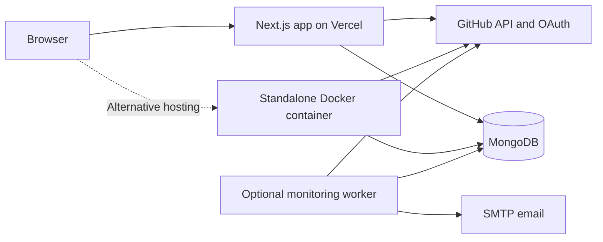

<div align="center">

# Branchline

**Smart Deployment Health Monitor**

Your repositories, changes, and application health — in one workspace.

[](https://branchline-rho.vercel.app)
[](https://hub.docker.com/r/adarshsingh000/branchline)
[](https://github.com/Adarsh011732/HealthMonitoring/actions/workflows/ci.yml)

[Try the dashboard](https://branchline-rho.vercel.app/dashboard/overview) · [Sign in with GitHub](https://branchline-rho.vercel.app/login) · [Report an issue](https://github.com/Adarsh011732/HealthMonitoring/issues)

</div>

## Explore the app

| Section | What you can do |
| --- | --- |
| **Overview** | See application health, response times, and recent repository changes. |
| **Repository** | Explore the commit graph, search commits, inspect changed files and patches, and browse repository metadata. |
| **Services** | Run health checks, inspect a monochrome latency chart, and export this browser session's check history as CSV. |
| **Deployments** | Read real GitHub Actions runs and GitHub deployment records for the selected public repository. |
| **Workspace** | Save public repositories to your account and switch between them without entering their names again. |
| **Settings** | Access account details, saved repositories, and email notification preferences. |

The interface uses a dark monochrome theme, responsive layouts, Motion transitions, and reduced-motion support. GitHub OAuth and Better Auth provide account sessions; MongoDB stores account and workspace data.

> Services measures the **Branchline instance**, not the deployed website of the selected repository. Health samples belong to the current browser session. GitHub activity depends on what the repository and its hosting provider publish. Scheduled email alerts require the separate monitoring worker described below.

## How it fits together



| Layer | Technology |
| --- | --- |
| Interface | Next.js App Router, React, TypeScript, Motion, Lucide |
| Server | Next.js Route Handlers, Node.js |
| Identity | Better Auth, GitHub OAuth |
| Storage | MongoDB |
| Hosting | Vercel; Docker as an alternative |
| Checks | Node test runner, TypeScript, production build, Docker build |

## Run it yourself

<details>
<summary><strong>Local development</strong></summary>

Install Node.js 24 or later and provide a MongoDB database and GitHub OAuth app for account features.

```bash
git clone https://github.com/Adarsh011732/HealthMonitoring.git
cd HealthMonitoring
npm ci
```

Copy `.env.example` to `.env.local` and configure the required values:

| Variable | Purpose |
| --- | --- |
| `MONGODB_URI` | MongoDB connection string |
| `MONGODB_DB` | Database name |
| `BETTER_AUTH_SECRET` | Random authentication secret, at least 32 characters |
| `BETTER_AUTH_URL` | `http://localhost:3001` for local development |
| `GITHUB_CLIENT_ID` | GitHub OAuth app client ID |
| `GITHUB_CLIENT_SECRET` | GitHub OAuth app client secret |

Generate an authentication secret with `node -e "console.log(require('node:crypto').randomBytes(32).toString('hex'))"` and store it only in your environment configuration.

For the local OAuth app, use `http://localhost:3001` as the homepage and `http://localhost:3001/api/auth/callback/github` as the callback. A separate OAuth app avoids changing the production callback when developing locally.

```bash
npm run db:setup
npm run dev
```

Open [localhost:3001](http://localhost:3001). MongoDB must allow connections from your machine. Never commit `.env.local`.

</details>

<details>
<summary><strong>Docker — pull the published image</strong></summary>

Published image: [`adarshsingh000/branchline`](https://hub.docker.com/r/adarshsingh000/branchline), with `latest` and `1.0.0` tags. The current image targets Linux AMD64.

```bash
docker pull adarshsingh000/branchline:1.0.0
docker run -d --name branchline --restart unless-stopped -p 3001:3000 --env-file .env.local adarshsingh000/branchline:1.0.0
```

Open [localhost:3001](http://localhost:3001). Supply your own runtime environment file and configure OAuth for the URL you use. Credentials are excluded from the image.

To build and run from source:

```bash
docker compose up -d --build
docker compose ps
docker compose down
```

The multi-stage image runs the standalone Next.js server as a non-root user and includes a `/health` health check.

</details>

<details>
<summary><strong>Deploy to Vercel</strong></summary>

1. Import the repository into Vercel with the Next.js framework preset, or deploy using the CLI below.
2. Add the required environment variables from the local setup section to Vercel's production environment.
3. Set `BETTER_AUTH_URL` to your production HTTPS URL.
4. Configure the GitHub OAuth homepage to that URL and callback to `https://YOUR_HOST/api/auth/callback/github`.
5. Allow the hosting environment to connect to MongoDB and redeploy after environment changes.

```bash
npx vercel deploy --prod
```

The current live app is **https://branchline-rho.vercel.app**. Its callback is `https://branchline-rho.vercel.app/api/auth/callback/github`.

Vercel hosts the web application. The optional persistent worker needs a separate host.

</details>

<details>
<summary><strong>Optional email monitoring worker</strong></summary>

The web app lets signed-in users manage notification preferences. Automatic workflow notifications require running the worker separately; the live Vercel deployment alone does not run this process.

Configure `SMTP_USER`, `SMTP_APP_PASSWORD`, and the email settings documented in `.env.example`. `GITHUB_TOKEN` is optional for server-side GitHub API requests. Google OAuth is also optional and requires both `GOOGLE_CLIENT_ID` and `GOOGLE_CLIENT_SECRET`.

```bash
npm run monitor:pipelines
```

Keep the process running on a persistent host. See [deployment instructions](docs/RUN_AND_DEPLOY.md) for operational details.

</details>

## Project map

```text
app/           Pages, layouts, styles, and API route handlers
components/    Dashboard, login, workspace, charts, and repository UI
lib/           Authentication, MongoDB, session, and GitHub integrations
scripts/       Database setup and the optional monitoring worker
tests/         Automated checks and isolated test data
docs/          Setup, deployment, and recovery notes
Dockerfile     Standalone production image
compose.yaml   Local container configuration
vercel.json    Vercel build configuration
```

Older infrastructure and legacy server files may remain in the repository for reference; they are outside the current Vercel deployment path. The current dashboard does not simulate releases or claim automated production rollbacks.

## API quick reference

| Method | Route | Purpose |
| --- | --- | --- |
| GET | `/health` | Instance health, uptime, and memory |
| GET | `/api/repository?repo=owner/name` | Public repository snapshot |
| GET | `/api/commit?repo=owner/name&sha=COMMIT_SHA` | Commit details and file patches |
| GET | `/api/pipelines?repo=owner/name` | Workflow runs and deployment records |
| GET / POST | `/api/workspace` | Account-scoped repositories and preferences; sign-in required |
| GET / POST | `/api/auth/*` | Authentication endpoints |

## Verification

```bash
npm run typecheck
npm test
npm run build
docker build -t branchline:latest .
```

The current release passed type checking, eight automated tests, a production build, and a Docker container health smoke test. Desktop and mobile browser checks were performed during UI recovery. GitHub Actions defines test, production-build, and Docker-build checks; the badge above links to the actual workflow status.

---

Built by **Adarsh Singh** for the CSE DevOps project.
[Live app](https://branchline-rho.vercel.app) · [Source](https://github.com/Adarsh011732/HealthMonitoring) · [Container](https://hub.docker.com/r/adarshsingh000/branchline)

